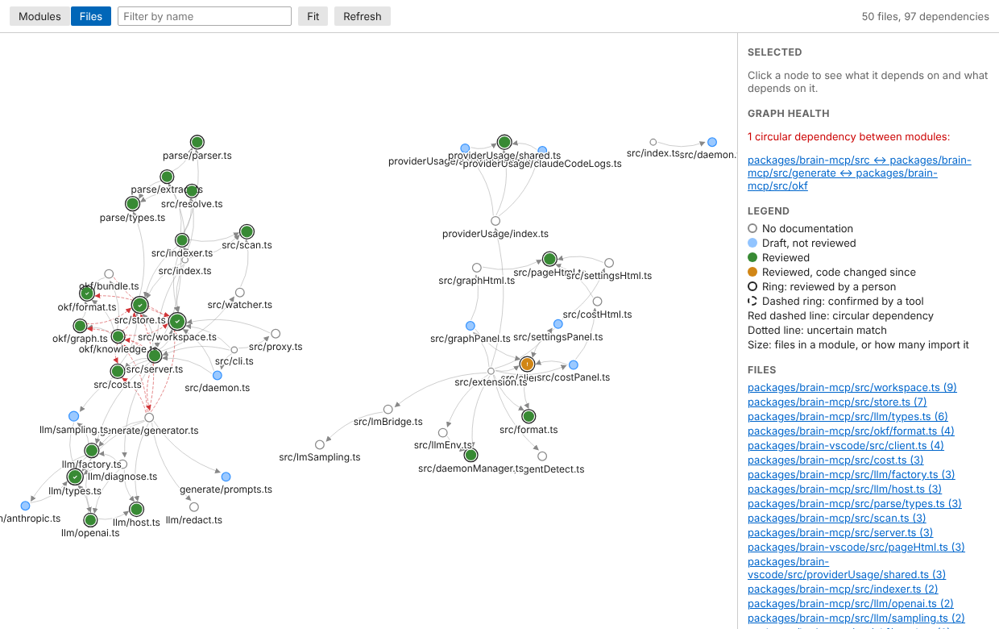
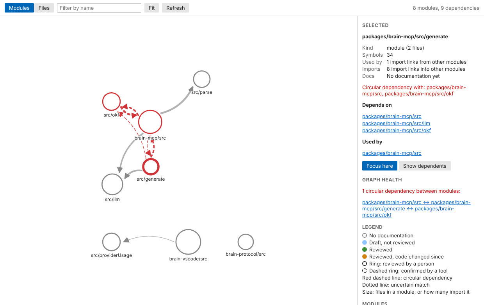
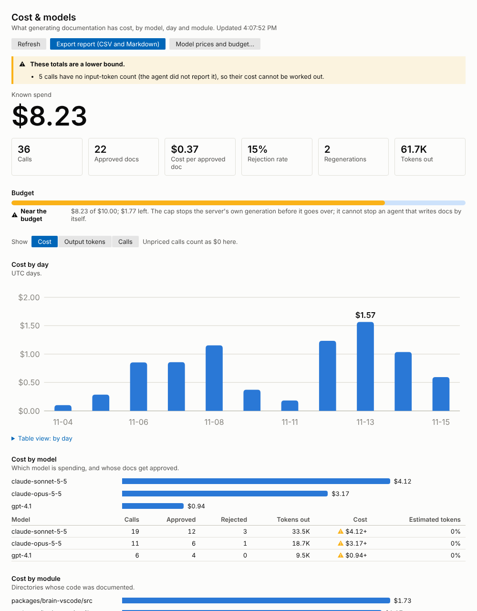
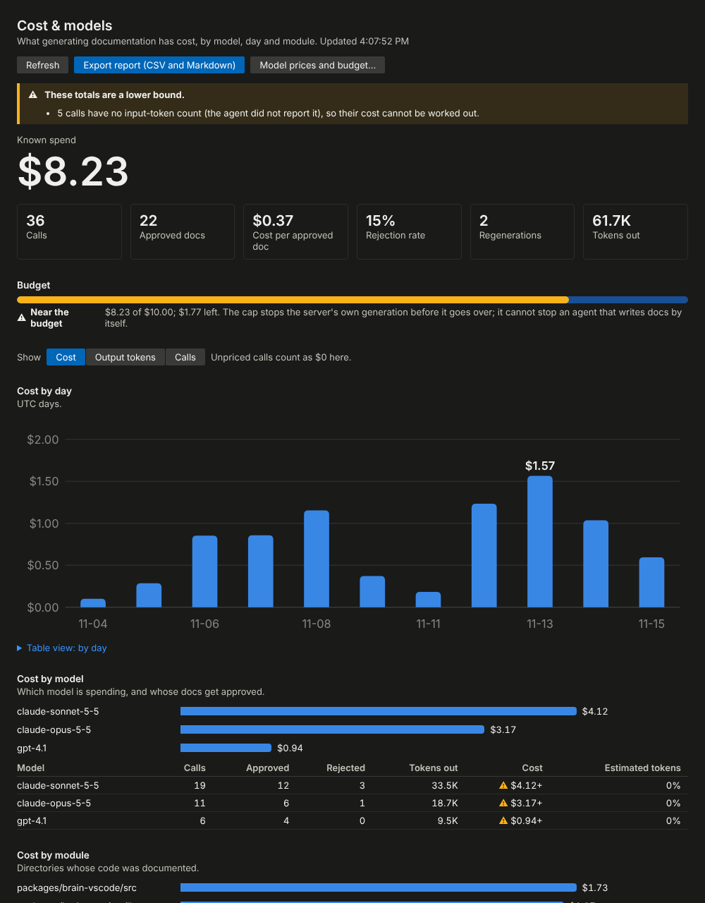
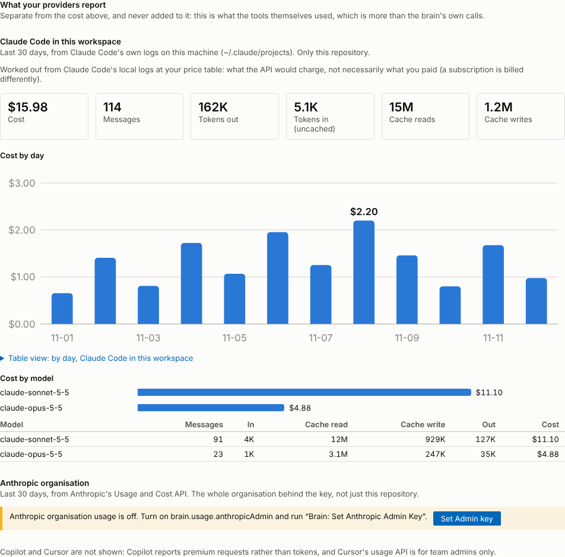
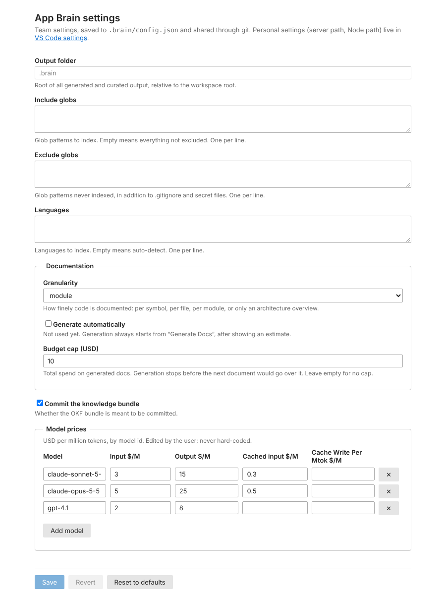

<p align="center">
  
</p>

# app-brain

**A knowledge base for your code that AI agents can query, written by agents and approved by people.**

app-brain indexes a code base, lets an agent (Claude Code, Copilot, Cursor, or a model the server calls itself) write plain-language documentation for it, and keeps that documentation out of the way until a person has reviewed it. What is approved becomes an [OKF](https://github.com/GoogleCloudPlatform/knowledge-catalog/blob/main/okf/SPEC.md) knowledge base in your repository, which agents then read through MCP instead of re-reading your code every time. A VS Code extension is the front end: set it up, review what was written, see the dependency graph, and see what it all costs.

- [PLAN.md](PLAN.md): the overall design and roadmap.
- [PLAN-VSCODE-EXTENSION.md](PLAN-VSCODE-EXTENSION.md): the extension, the MCP server behind it, the OKF format, cost and usage. Its §13 says what is built, what is not and what comes next.

## How it fits together

```
  Claude Code · Copilot · Cursor            VS Code extension (a front end only)
        │  MCP (read-only tools)                     │  MCP (admin tools, token-gated)
        └──────────────────┬─────────────────────────┘
                           ▼
              brain-mcp: one shared server per workspace (127.0.0.1, bearer token)
                tree-sitter index ─ SQLite + FTS5 ─ OKF knowledge base ─ doc generation ─ cost
                           ▼
        <your repo>/.brain/   config.json · drafts/ · knowledge/ · feedback/ · (cache, reports: gitignored)
```

1. **Index.** The server parses your code (TypeScript, TSX, JavaScript, Python) into symbols and import edges and keeps them current.
2. **Draft.** An agent calls `list_undocumented` and `save_summary`, or you run **Brain: Generate Docs** and the server writes them with a model you choose. Everything is saved as an **unreviewed draft** in `.brain/drafts/`.
3. **Review.** You approve or reject drafts in VS Code, one at a time or many at once. Approving moves a draft into `.brain/knowledge/` as stable, human-verified OKF.
4. **Use.** Agents ask for a file's or module's reviewed documentation (`get_overview`), search, walk the dependency graph and see what a change would affect. When the code changes after a doc was approved, the doc is marked stale.

## Screenshots

These come from a demo workspace (a copy of this repository's own source, indexed by the real server). The documents, token counts and prices are invented for the demo; the graph, the cost arithmetic and the layout are the real thing. `node scripts/screenshots.js` regenerates them. The Review Queue and the status bar are VS Code's own interface, which a browser cannot draw, so they are not shown.

**Dependency graph.** Each node is coloured by documentation status (none, draft, reviewed, reviewed but the code changed since) and ringed by who reviewed it; circular dependencies are red. Click a node to see what it uses and what uses it.

<p align="center"></p>
<p align="center"></p>

**Cost & Models.** What generating documentation has cost, by day, model and module, with a budget meter. Counts are marked exact or estimated, and a total that cannot be fully priced says so instead of looking complete. Light and dark follow your VS Code theme.

<p align="center"> </p>

**What your providers report.** Under the brain's own cost, apart from it and never added to it: what Claude Code used in this workspace (from its local logs) and, with an Admin API key, what your Anthropic organisation used and was billed.

<p align="center"></p>

**Settings.** A form generated from the server's own config schema, with inline errors and a model-price table.

<p align="center"></p>

## Install

- **Extension:** published on the Visual Studio Marketplace as **App Brain** (`danielonnet.app-brain`). Or build it yourself: `scripts/build-and-install.sh` packages a `.vsix` and installs it into your local VS Code.
- **Needs Node 22.16 or newer** for the server. It uses Node's built-in `node:sqlite` with full-text search, which Node 22.13 to 22.15 ship without; the server says so if yours is too old.
- **First run:** open a folder, run **Brain: Initialise** (creates `.brain/`; before that nothing is written to your workspace and the index lives in memory), then **Brain: Copy MCP Config for Claude Code** to connect an agent. With `brain.registerWithCopilot` on, the server is also offered to Copilot's agent mode.
- **Without VS Code:** `node packages/brain-mcp/out/cli.js --workspace /path/to/repo` is a normal stdio MCP server. Agents get the read-only tools; the admin tools need the token in `BRAIN_ADMIN_TOKEN`.

## What it does

### Indexing

tree-sitter (WASM) symbols for TypeScript, TSX, JavaScript and Python; import edges between files; a SQLite + FTS5 store; incremental re-index by modification time and content hash; a file watcher. The index moves to `.brain/.cache/brain.db` (gitignored) on **Brain: Initialise**. Secret files (`.env*`, keys, certificates) and everything in `.gitignore` are never indexed.

### What agents get

Read-only tools, no token: `search_code`, `get_symbol`, `get_neighbors`, `impact_of_change`, `get_graph`, `get_overview` (the reviewed doc for a file or module, with its trust tier and a warning when the code changed since), `list_undocumented` (ranked by how many files import each target) and `save_summary`. Every call is logged (client, tool, tokens returned, latency); the extension shows it as **Agent Activity** and flashes the status bar when an agent calls the brain.

### The knowledge base

`.brain/knowledge/` is an [OKF v0.2](https://github.com/GoogleCloudPlatform/knowledge-catalog/blob/main/okf/SPEC.md) bundle: Markdown with YAML front matter. The server maintains `index.md` and `log.md`, and a managed **Dependencies** block at the bottom of each document (text outside the block is yours and is never touched). Staleness is computed from a content hash of the code, never written into the files. Rejections and edits are kept in `.brain/feedback/` and given to the model on the next attempt. **Brain: Validate Knowledge Bundle** checks conformance, broken links, orphans and cycles.

An approved document, abridged (the real front matter also carries `generated`, `sources` and the full `llm` block):

```markdown
---
type: Brain File
title: src/auth/session.ts
description: Creates and looks up user sessions.
resource: ../../../../../src/auth/session.ts
status: stable
verified:
  by: human:jdoe
  at: 2026-11-17T14:33:05.892Z
brain:
  target: src/auth/session.ts
  kind: file
  built_from_hash: aaee433b43a2bebb328ba873a4824efd1c613d19
  depends_on:
    - /files/src/db/pool.ts.md
  llm: { model: claude-sonnet-5-5, mode: agent, tokens_in: 51200, tokens_out: 1420, tokens_source: agent-reported }
---
# Summary

Handles sessions, backed by the connection pool.

<!-- brain:auto:start dependencies -->
# Dependencies

- Depends on: [src/db/pool.ts](../db/pool.ts.md)
- Used by: [src/http/login.ts](../http/login.ts.md)
<!-- brain:auto:end -->
```

Links are **relative**, which OKF allows beside bundle-absolute ones, so ctrl+click opens them in VS Code and any Markdown viewer (a leading slash there means the workspace root, not the bundle). A link to a file nobody has documented yet is allowed by OKF and opens once that file is documented. Trust tiers come from `verified`: unverified, machine-confirmed, human-reviewed.

### Review

The **Review Queue** lists the drafts waiting for a person. Open one, edit it, approve or reject it (a rejection can carry a note for the next attempt). With hundreds, select several and approve them together from the right-click menu, or use **Brain: Approve Many Drafts…** (the checklist icon in the view's title bar): all new drafts for unchanged code, everything in the folders you tick, or a list you tick one by one. The first choice leaves out drafts whose code changed since they were written and drafts that would replace a doc someone already reviewed. You confirm once, with what it means said plainly, and each document approved this way is marked `approved_in_bulk` in its front matter so it can be told apart from one read one by one. A thousand drafts take about three seconds on the server.

An agent cannot approve its own work: review is an admin tool, and the admin token goes only to the extension.

### Writing the docs

An agent can write them (`save_summary`), or **Brain: Generate Docs** lets the server do it. By default (`auto`) the server detects your setup: the editor's language model if there is one, otherwise the connected agent. It never picks an API key or a local model unless you choose one.

| Mode | Who writes | Tokens and cost | Leaves your machine |
|---|---|---|---|
| `auto` (default) | Detects your setup: the editor's language model, otherwise the connected agent | As the mode it picks | As the mode it picks |
| `agent` | A connected MCP agent (Claude Code, Cursor, Copilot) through `save_summary` | Reported by the agent, or estimated | Whatever that agent's provider does |
| `vscode-lm` | The first available VS Code language model (for example Copilot), asked over MCP sampling; VS Code asks for consent | Measured by the editor's tokenizer, or estimated | Whatever that model's provider does |
| `api-key` | Claude, through the official SDK, with a key in VS Code's secret storage (**Brain: Set LLM API Key**) | Exact, from the API's usage | Yes: source code goes to Anthropic. Anything that looks like a credential is removed first |
| `local` | A model you host (Ollama, LM Studio, llama.cpp, any OpenAI-compatible server), chosen with `brain.llm.local.preset` and **Brain: Choose Local Model** | Free on this machine or network; server-reported when it reports usage | Not if the URL is on this machine; otherwise the confirmation says exactly where your code goes |

Before anything is spent you see an estimate (every number labelled as one) and confirm. The job is bottom-up (files by how many others import them, then modules from the deepest up, so a module reads the summaries of what it contains), runs one document at a time, shows progress and can be cancelled mid-call. The budget cap is enforced here: before each call the server prices its worst case and stops rather than risk going over, and it refuses to start with a cap if the model has no price. A refusal, a truncated answer or an unusable one is recorded as a problem, still counted in the cost report, and never kept. Three failures in a row stop the job; a rejected key stops it at once. Everything written is still a draft. The code is treated as data: all repository text sits inside a fence with a random id that the code cannot close, and a model's output cannot forge a review or the managed dependency block.

**Local models** need two things beyond a URL. **Brain: Test LLM Connection** says what is wrong in plain words (the server is not running, the model is not pulled, the URL is not on this machine). And `brain.llm.local.contextTokens` must match the context window your server really runs the model with: servers often default to 2 to 4K tokens and cut longer prompts off silently. Prompts are sized to it, anything cut says so in the doc, and files that cannot fit are skipped and reported.

### Cost

Every document written is recorded with the model, the token counts and where they came from (exact from the provider, reported by the agent, or estimated). Prices are your own table (no shipped defaults, so nothing is silently wrong); a call made before its model had a price is priced from today's table, but only when both token counts are known. When a total cannot be fully priced the view says it is a lower bound and why. The budget cap stops the server's own generation before it would go over; it cannot stop an agent that writes docs on its own. **Brain: Export Cost Report** writes CSV and Markdown into `.brain/reports/` (safe to open in a spreadsheet).

**Provider usage.** Under that, **Cost & Models** can show what the tools themselves report, apart from the brain's own cost:

- **Claude Code in this workspace** (on by default), read from the session logs Claude Code keeps on this machine (`~/.claude/projects`, or `CLAUDE_CONFIG_DIR`). Only token counts, the model, the time and the working directory are read, never what was typed or answered. Cost is worked out from your price table (a cache read at 0.1x the input price, a cache write at 1.25x or 2x unless the table says otherwise), so it is what the API would charge, not what a subscription costs you.
- **Anthropic organisation** (off by default), from the Usage and Cost Admin API: tokens by day and model, and the dollars Anthropic billed. It needs an Admin API key from a Claude Console organisation (**Brain: Set Anthropic Admin Key**; kept in VS Code's secret storage, sent only to api.anthropic.com) and it covers the whole organisation, not just this repository.

- **GitHub Copilot Chat in this workspace** (on by default), read from the chat session files VS Code keeps for this workspace. Only token counts, Copilot's own credit figure, the model and the time are read. Output tokens are complete; input is a lower bound, because the log keeps only the last round of each agent turn. Credits are shown as Copilot reports them and are not converted to dollars; cost appears only for models you have priced.

Settings: `brain.usage.claudeCodeLogs`, `brain.usage.copilotLogs`, `brain.usage.anthropicAdmin.enabled`, `brain.usage.lookbackDays` (1 to 90, default 30). Cursor is not included yet: its usage API is for team admins.

### Semantic search

Off by default. Set `brain.search.embeddings.model` to an embedding model your local server runs (for example `ollama pull nomic-embed-text`, then `nomic-embed-text`) and `search_code` finds code by meaning as well as by words: "sign a user in" finds `verifyCredentials`. Keyword and meaning results are merged (reciprocal rank), so an exact name still comes first. Agents can force either with `mode: "keyword"` or `"semantic"`.

- Only symbol names, signatures, doc comments and paths are embedded, never function bodies. They go to the URL in `brain.search.embeddings.baseUrl` (default: local Ollama). If that is not your machine, that text leaves it.
- The address is a personal setting sent by the extension each time it connects. It is never read from `.brain/config.json`, so a cloned repository cannot choose where your code goes.
- Vectors are computed in the background after each index run, kept in the local database, and reused when a symbol's text is unchanged. If the embedding server is down, search falls back to keywords and says so. **Brain: Check Semantic Search** shows progress.

### Call and inheritance links, and the editor surfaces

- **Language-server links.** After you save a file, the extension asks the editor's own language servers (call hierarchy and type hierarchy, so whatever your language extensions provide) which files that file's code calls and extends, and stores them beside the import links (`source: lsp`). Call links work with most languages; inheritance links only appear for languages whose server provides a type hierarchy (for example Java or C#; VS Code's built-in TypeScript support does not, so there a subclass is linked to its base only through the import link). Run **Brain: Update Call and Inheritance Links** for the whole workspace. Nothing leaves your machine. If no language server answers, nothing is changed. Turn it off with `brain.edges.languageServer`.
- **Documentation Coverage** view: every file and module grouped as stale, draft, undocumented or reviewed, with the share reviewed.
- **CodeLens** above a file whose doc is missing, waiting for review, or stale; a current doc shows nothing (`brain.codeLens.docStatus`).
- **Brain: Check Agent Connection** says which agents are connected now and which have called the brain.

### One shared server, and its security

By default (`brain.server.transport`: `http`) the extension starts one `brain-mcp` daemon per workspace on `127.0.0.1`, and every client uses it: the extension, and any agent whose usual stdio config quietly becomes a proxy to it. The code is indexed once, and the extension shows what agents ask as it happens.

- It listens on loopback only, needs a bearer token, and rejects browser requests and unexpected `Host` headers.
- `server.json` (with the *agent* token, read-only tools) is in a per-user runtime directory, not in your workspace. The *admin* token and any API key are never in a file, the environment or the command line: they are passed on stdin and kept in memory, so an agent cannot approve its own drafts by reading a file.
- It stops when the editor closes if the editor was its only client, stays up for agents or another window otherwise, and exits after ten minutes with nobody connected. If it cannot start, the editor uses a private server and says so.
- Anything sent to a model has credential-looking text removed first, and a model's answer is never trusted to contain a review or the managed block.
- Run it yourself with `node packages/brain-mcp/out/cli.js --daemon --workspace .`; `--no-proxy` makes a stdio server run on its own even when a daemon exists.

## Commands

| Command | What it does |
|---|---|
| Brain: Initialise | Creates `.brain/` (config, OKF bundle, `.gitignore`); never overwrites |
| Brain: Start / Stop Server, Reindex Workspace | Server lifecycle and a manual incremental re-index |
| Brain: Open Settings | The settings form, with model prices and the budget cap |
| Brain: Generate Docs… / Cancel Doc Generation | Server-side generation, after an estimate and a confirmation |
| Brain: Approve Many Drafts… | Bulk approval by scope; also Approve and Reject on a selection in the Review Queue |
| Brain: Show Cost & Models / Export Cost Report | The cost view; CSV and Markdown export |
| Brain: Show Dependency Graph / Export Graph (JSON-LD) | The graph view; `.brain/graph/graph.jsonld` |
| Brain: Search Symbols, Validate Knowledge Bundle | Search the index; check the OKF bundle |
| Brain: Test LLM Connection, Choose Local Model… | Diagnose and pick a local model |
| Brain: Set / Clear LLM API Key, Set / Clear Anthropic Admin Key | Keys, in VS Code's secret storage |
| Brain: Copy MCP Config for Claude Code, Open Output Folder, Show Server Logs | Connecting agents and finding things |

## Where we are

**Built:** the index and agent tools; the OKF knowledge base with drafts, review, bulk review, feedback and validation; generation by an agent, the editor's model, a Claude API key or a local model; the shared daemon and its security; the dependency graph; cost reporting and provider usage for Claude; the settings form; CI on Linux, macOS and Windows, and publishing to the Marketplace.

**Not built yet:** notes (`add_note`) and MCP prompts; SCIP import (call and inheritance links come from the editor's language servers when you have them, otherwise edges are tree-sitter import matches); diff and edit inside the Review Queue, feedback buttons; usage levels 2 and 3; Cursor usage; automatic generation after indexing (`docs.autoGenerate` is reserved and does nothing); a CLI and a docs site export; more languages. And the benchmarks that would show whether any of this makes agents better.

**Not yet checked by hand:** a full session in a real VS Code window, a real Anthropic Admin key, a real Ollama server, and macOS and Windows behaviour beyond what the tests cover. See [PLAN-VSCODE-EXTENSION.md](PLAN-VSCODE-EXTENSION.md) §13 for the detail and the order of what comes next.

## Develop

```sh
npm install
npm test        # builds, then runs the server and extension tests (Node 22.16+)
```

About 390 tests run on Linux, macOS and Windows for every pull request (`.github/workflows/ci.yml`); the webview tests drive a real Chromium against data from the real server.

- **Run the extension:** open this folder in VS Code and press F5 (“Run App Brain extension”), then open any folder in the new window.
- **Build and install the `.vsix`:** `scripts/build-and-install.sh` (`--skip-tests`, `--package-only`). It bundles the server and its production dependencies.
- **Release:** change the version in `packages/brain-vscode/package.json` in a pull request and merge it. The push to `main` runs `.github/workflows/publish.yml`: tests, package, publish to the Marketplace through trusted publishing, and a GitHub release `vX.Y.Z`. A version that already has its tag is never published twice.
- **Screenshots:** `npm run build && node scripts/screenshots.js` (needs Playwright with Chromium).
- **Layout:** `packages/brain-protocol` (shared types and schemas), `packages/brain-mcp` (the server), `packages/brain-vscode` (the extension).
